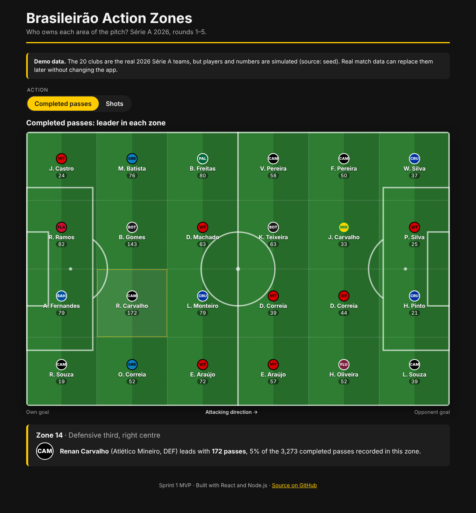
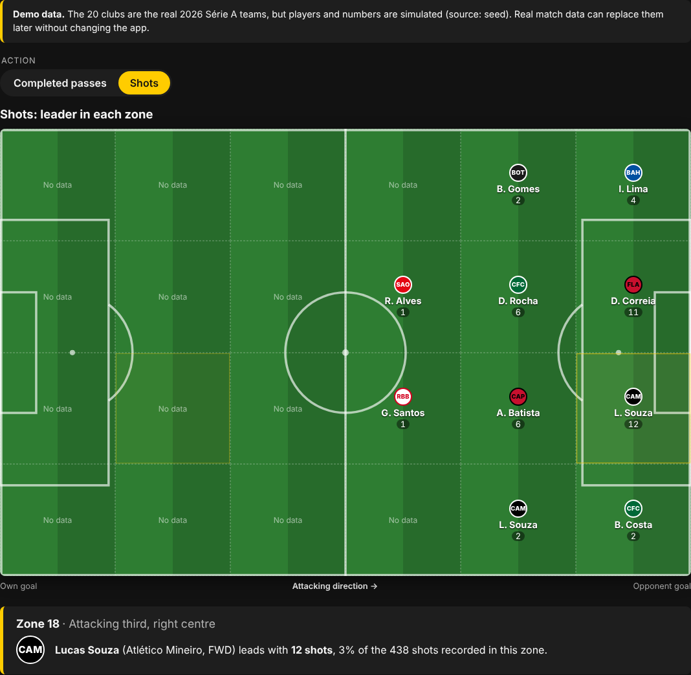
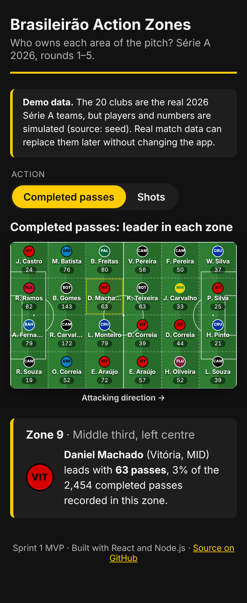
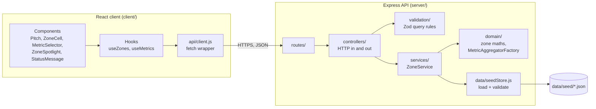

# Brasileirão Action Zones

**See which Brasileirão Série A player leads each zone of the pitch, for passes, shots and more.**

[](https://github.com/gxrciafelipe/football-stats/actions/workflows/ci.yml)

- **Live app:** https://football-stats.onrender.com
- **Jira project:** [Football Stats Brasileirao (FSB)](https://my-team-zi6lrqaa.atlassian.net/jira/software/projects/FSB/boards/34/backlog)
- **Status:** Sprint 1 MVP (v0.1.0)



## The problem

Fans and Cartola FC (fantasy league) managers can easily find a player's _totals_, but not _where_ on the pitch those actions happen. Questions like "who controls the left half-space?" or "who shoots most from inside the box?" usually need paid scouting tools. Action Zones splits the pitch into a grid and names the player who leads each zone, across the whole league, on one screen.

> **Demo data:** the 20 clubs are the real 2026 Série A teams, but the **players and all numbers are simulated** by a seeded generator (see [Data](#data)). The app labels this on every page. A licensed data source can replace the generator later without changing the UI.

## Features (Sprint 1)

| Feature                                                                               | Story          |
| ------------------------------------------------------------------------------------- | -------------- |
| Pitch with to-scale markings, split into a 6 × 4 grid of zones                        | FSB-8          |
| Each zone shows the leading player's club badge, name and count; empty zones say so   | FSB-8          |
| Switch between **completed passes** and **shots** without reloading                   | FSB-9          |
| Click (or Tab + Enter) a zone to see the leader's share of that zone in the spotlight | FSB-8          |
| Loading, "updating" and error states with a retry button                              | FSB-8          |
| REST API with validation and one JSON error format                                    | FSB-7          |
| Deterministic seed dataset: 20 clubs, 280 players, 5 rounds, about 67,000 events      | FSB-6          |
| CI on every pull request; auto-deploy to Render after checks pass                     | FSB-10, FSB-11 |

<table>
  <tr>
    <td width="62%"></td>
    <td></td>
  </tr>
  <tr>
    <td align="center">Shots metric with a zone selected</td>
    <td align="center">Phone layout</td>
  </tr>
</table>

## Tech stack

| Layer      | Choice                                            | Why                                                                      |
| ---------- | ------------------------------------------------- | ------------------------------------------------------------------------ |
| Frontend   | React 19 + Vite 7                                 | Component model fits a grid of repeated zones; fast dev server and build |
| Backend    | Node.js 22 + Express 5                            | Same language on both sides; Express 5 forwards async errors itself      |
| Validation | Zod                                               | One schema style for query strings and the seed files                    |
| Security   | Helmet, express-rate-limit                        | Security headers and 100 requests/minute per IP                          |
| Testing    | Vitest, Supertest, React Testing Library, jsdom   | One test runner for client and server                                    |
| Quality    | ESLint 9, Prettier, EditorConfig                  | Same style everywhere, enforced in CI                                    |
| CI/CD      | GitHub Actions + Render Blueprint (`render.yaml`) | Tests on every PR; deploys only a green `main`                           |

## Getting started

**Requirements:** Node.js 20.19 or newer (22 recommended, see `.nvmrc`) and npm 10.

```bash
git clone https://github.com/gxrciafelipe/football-stats.git
cd football-stats
npm install
npm run dev
```

`npm run dev` starts both apps with live reload:

- **Client:** http://localhost:5173 (Vite proxies `/api` to the server)
- **API:** http://localhost:3001/api/health

To run the production build locally (one server for API and client):

```bash
npm run build
npm start          # http://localhost:3001
```

### Scripts

| Command                           | What it does                                                       |
| --------------------------------- | ------------------------------------------------------------------ |
| `npm run dev`                     | Start client and server together                                   |
| `npm test`                        | Run all server and client tests                                    |
| `npm run test:coverage`           | Tests with coverage reports (`server/coverage`, `client/coverage`) |
| `npm run lint`                    | Lint all code with ESLint                                          |
| `npm run format` / `format:check` | Format with Prettier / check formatting                            |
| `npm run build`                   | Build the client into `client/dist`                                |
| `npm start`                       | Start the server (serves `client/dist` if it exists)               |
| `npm run seed -w server`          | Regenerate the seed dataset (always identical output)              |
| `npm run smoke -- <url>`          | Check a running instance, e.g. the live app                        |

## Usage

1. Open the app. The pitch loads with **Completed passes**.
2. Each zone shows the player with the most completed passes there: club badge, short name and count.
3. Choose **Shots** to see who shoots most from each area. Most zones in your own half say "No data", which is expected.
4. Click a zone (or Tab to it and press Enter) to see the full name, position and their share of all actions in that zone.

The pitch is always drawn with every team **attacking left to right**: your own goal is on the left, the opponent's on the right. The top edge is the left touchline.

## API

All responses are JSON. Base URL: `/api`.

| Method | Endpoint       | Description                                          |
| ------ | -------------- | ---------------------------------------------------- |
| GET    | `/api/health`  | Liveness check: `{ status, version, uptimeSeconds }` |
| GET    | `/api/metrics` | Metrics the client can offer                         |
| GET    | `/api/teams`   | The 20 clubs with badge colours                      |
| GET    | `/api/zones`   | Leader of every zone for one metric                  |

`GET /api/zones` query parameters:

| Parameter | Required | Values               | Default |
| --------- | -------- | -------------------- | ------- |
| `metric`  | yes      | `passes`, `shots`    | none    |
| `cols`    | no       | whole number 1 to 12 | `6`     |
| `rows`    | no       | whole number 1 to 8  | `4`     |

Example: `GET /api/zones?metric=passes&cols=6&rows=4`

```json
{
  "metric": { "id": "passes", "label": "Completed passes", "unit": "passes" },
  "grid": { "cols": 6, "rows": 4 },
  "source": "seed",
  "demo": true,
  "zones": [
    {
      "zoneId": 0,
      "col": 0,
      "row": 0,
      "total": 477,
      "leader": {
        "playerId": "vitoria-04",
        "name": "Jean Castro",
        "position": "DEF",
        "count": 24,
        "team": { "id": "vitoria", "name": "Vitória", "code": "VIT", "...": "..." }
      }
    }
  ]
}
```

Zones are numbered row by row from the top-left corner (`zoneId = row × cols + col`). `leader` is `null` when nobody recorded that action in the zone.

Every error has the same shape:

```json
{
  "error": {
    "code": "INVALID_METRIC",
    "message": "Unknown metric \"x\". Use one of: passes, shots."
  }
}
```

| Status | Code             | When                                                                     |
| ------ | ---------------- | ------------------------------------------------------------------------ |
| 400    | `INVALID_METRIC` | `metric` missing or unknown                                              |
| 400    | `INVALID_QUERY`  | `cols` / `rows` not a whole number in range (`details` lists the fields) |
| 404    | `NOT_FOUND`      | Unknown API route                                                        |
| 429    | `RATE_LIMITED`   | More than 100 requests a minute from one IP                              |
| 500    | `INTERNAL_ERROR` | Unexpected failure (details only in the server log)                      |

## Architecture



The client and the API ship as **one Render web service**: Express answers `/api/*` and serves the built React app for everything else. That means one URL, no CORS setup and one deploy.

### Separation of concerns

| Layer        | Folder                    | Responsibility                                                     |
| ------------ | ------------------------- | ------------------------------------------------------------------ |
| Data         | `server/src/data`         | Load the seed files, validate them, index teams and players        |
| Domain       | `server/src/domain`       | Pure rules: which zone a point is in, which events a metric counts |
| Service      | `server/src/services`     | Business logic: find each zone's leader; knows nothing about HTTP  |
| Controller   | `server/src/controllers`  | Read the request, call the service, send JSON                      |
| Routes       | `server/src/routes`       | Map URLs to controllers                                            |
| Middleware   | `server/src/middleware`   | One JSON error format for every failure                            |
| UI           | `client/src/components`   | Presentational components that only render props                   |
| State / data | `client/src/hooks`, `api` | Fetching, loading and error state                                  |

### Design patterns

- **Factory**: `MetricAggregatorFactory` (`server/src/domain/metrics.js`) creates one aggregator class per metric from a registry. Each metric owns its counting rule (passes count only completed passes, shots count every attempt). Adding tackles in Sprint 2 means one new class and one registry line, with no `if/else` in the service.
- **MVC / layered architecture**: the server splits into model (data + domain), controller and routes. The React components are the view. Each layer is tested on its own: the service with a hand-made fake store, the controllers through Supertest.
- **Application factory with dependency injection**: `createApp({ store })` builds the Express app without starting it. Tests inject datasets and a fake client build. `server.js` is the only file that listens on a port.
- **Container / presentational components**: `App` and the hooks own state and data fetching. `Pitch`, `ZoneCell` and `ZoneSpotlight` only render props, which keeps them simple to test.

### Key decisions

- **Seed data instead of scraping.** Free Brasileirão event data with pitch coordinates is not available under a licence that allows this use. Scraping sites like Sofascore breaks their terms and gets blocked. A deterministic generator gives realistic, stable data, and the data layer can be swapped for a licensed API later (FSB-13).
- **Server-side aggregation.** Counting about 67,000 events into zones takes around 4 ms on the server. The client receives just 24 small objects.
- **Club badges instead of crests.** Official crests are trademarks and hot-linked images break. Badges are drawn from club colours and a 3-letter code.
- **Coordinates 0 to 100** on both axes, so any grid size is a simple division (`col = floor(x × cols / 100)`), with points on the far edge kept in the last zone.

## Data

`npm run seed -w server` runs `server/scripts/generate-seed.js`, which writes four files to `server/data/seed/`:

| File           | Contents                                                             |
| -------------- | -------------------------------------------------------------------- |
| `teams.json`   | The 20 clubs of Série A 2026 with badge colours                      |
| `players.json` | 14 fictional players per club (GK, DEF, MID, FWD)                    |
| `matches.json` | Rounds 1 to 5: every club plays once per round                       |
| `events.json`  | About 67,000 passes, shots, tackles and touches with x/y coordinates |

Each player's actions cluster around their position (full-backs on the flanks, strikers' shots inside the box). The generator uses a fixed random seed, so the output is identical on every run. The server validates all four files with Zod at start-up and refuses to start with a clear message if anything is wrong.

## Testing

```bash
npm test                # all tests
npm run test:coverage   # with coverage
```

| Level                | Tools                          | What is covered                                                                                        |
| -------------------- | ------------------------------ | ------------------------------------------------------------------------------------------------------ |
| Unit (server)        | Vitest                         | Zone maths incl. the x = 100 edge, metric rules, factory, tie-breaking, seed validation, error handler |
| Integration (server) | Vitest + Supertest             | Every endpoint: success, custom grid, 400s for bad input, 404, 429, client hosting                     |
| Unit (client)        | Vitest + React Testing Library | Pitch rendering, empty zones, keyboard use, spotlight text, metric selector, API client errors         |
| Integration (client) | Vitest + mocked `fetch`        | App loads zones, switches metric, shows the error state and recovers on retry                          |
| Smoke (deployment)   | `npm run smoke -- <url>`       | Live health, zones, error handling and home page                                                       |

**Coverage at v0.1.0:** 78 tests. Server 100% lines / 97% branches; client 100% lines / 98% branches. CI fails if server coverage drops below 80% lines or 70% branches.

## CI/CD and Git workflow

- **Branches:** `main` (production) ← `develop` (integration) ← one `feature/FSB-<n>-<name>` branch per Jira story, merged through pull requests.
- **Commits** follow [Conventional Commits](https://www.conventionalcommits.org/) with the Jira key, for example `feat(FSB-7): expose zones, metrics and teams endpoints`.
- **CI** (`.github/workflows/ci.yml`) runs on every pull request and push to `main`/`develop`: install, lint, format check, tests with coverage gates, client build. Coverage reports are uploaded as artifacts.
- **CD:** `render.yaml` defines the service. Render deploys `main` automatically **only after the CI checks pass**, then checks `/api/health` before switching traffic.
- **Smoke test:** run the "Smoke test" workflow in the Actions tab, or `npm run smoke -- https://football-stats.onrender.com`.

## Deployment

1. Sign in to [Render](https://render.com) with GitHub.
2. **New → Blueprint**, pick this repository and confirm. Render reads `render.yaml` and creates the `football-stats` web service on the free plan.
3. The first deploy runs `npm ci --include=dev && npm run build`, then `npm start`.
4. After that, every merge to `main` that passes CI deploys automatically.

## Troubleshooting

| Problem                                                                                       | Fix                                                                                                                                                     |
| --------------------------------------------------------------------------------------------- | ------------------------------------------------------------------------------------------------------------------------------------------------------- |
| `npm install` fails or Vite says Node is too old                                              | Install Node 22 (`nvm install 22`, or nvm-windows on Windows) and run `npm install` again                                                               |
| `Error: listen EADDRINUSE :3001` or `:5173`                                                   | Another process uses the port. Stop it, or start with another port: `PORT=3002 npm run dev -w server` (and update the proxy in `client/vite.config.js`) |
| The page says "Could not reach the server"                                                    | The API is not running. Use `npm run dev` (both apps), not only the client                                                                              |
| The live app takes up to a minute to load the first time                                      | Free Render instances sleep after 15 minutes idle; the first request wakes them up                                                                      |
| Server stops with `Seed data invalid in events.json ...`                                      | A seed file was edited by hand. Run `npm run seed -w server` to regenerate it                                                                           |
| `npm run format:check` fails after editing on Windows                                         | Run `npm run format`. `.gitattributes` keeps line endings as LF                                                                                         |
| Errors about `@rollup/rollup-...` or `esbuild` after copying `node_modules` between computers | Delete `node_modules` and run `npm install` on that computer                                                                                            |

## Known limitations

- **Simulated data:** players and numbers are generated, not real statistics.
- **Five rounds** of data only, and no filters yet (team, position, rounds).
- **Fixed 6 × 4 grid** in the UI, although the API already accepts other sizes.
- **Two metrics** (completed passes, shots). Tackles and touches exist in the data but are not exposed yet.
- **Only the zone leader** is shown. The top 5 per zone is planned.
- **Cold starts** on Render's free plan, as described in Troubleshooting.

## Roadmap

- **Sprint 2 (feature development):** onboarding guide (FSB-23), top 5 players per zone (FSB-12), `DataProvider` interface with a cached decorator (FSB-13), tackles and touches (FSB-14), team, position and round filters (FSB-15 to FSB-17), grid sizes 6 × 3 / 6 × 4 / 12 × 8 (FSB-18), heatmap shading (FSB-19).
- **Sprint 3 (testing and deployment):** Playwright end-to-end tests, Sentry error tracking and uptime monitoring, complete documentation (FSB-20 to FSB-22).
- **Later:** a licensed live data provider, per-90 statistics and shareable pitch images.

## Author

Felipe Garcia, Software Development final project, Madonna University, Fall 2026.
